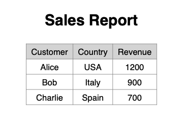

# PDF Report Generator Bot

## Problem
Turning a CSV table into a clean, printable PDF report by hand is repetitive.

## Example output
Generated from `examples/sample_input.csv` (full file: `examples/sample_output.pdf`):



## What it does
- Reads a CSV file; the first row is used as the table header.
- Renders all rows as an A4 table with a grey header row, grid lines and centred cells; long tables continue on the next page.
- Adds the title "Sales Report" above the table.
- Writes the result to `output/report.pdf`.

Values are printed as they appear in the CSV: no totals, sorting or number formatting.

## Quick start
Tested with Python 3.11.

```bash
pip install -r requirements.txt
python src/main.py
```

The report is written to `output/report.pdf` (git-ignored). To use other files:

```bash
python src/main.py --input path/to/table.csv --output path/to/report.pdf
```

## Sample data
`examples/sample_input.csv` contains three customers with country and revenue.
If the file is missing and no `--input` is given, the script recreates it before running.

## Adapting it to your data
Pass any CSV table with `--input`: header in the first row, same number of columns in every row.
The title is fixed to "Sales Report"; change that string in `src/main.py` for other reports.
